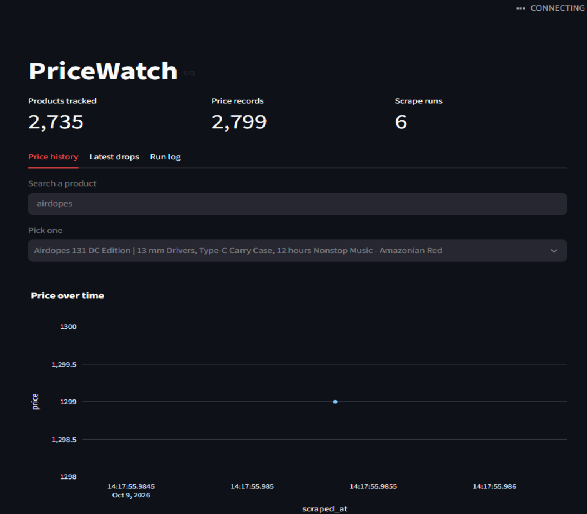

# PriceWatch

An end-to-end price-tracking pipeline for Shopify stores. It scrapes product
feeds on a schedule, stores price history, detects drops, and sends Telegram
alerts. A Streamlit dashboard shows the data.



## Features

- **Scrapy spider** for any Shopify store's public `/products.json` feed (every variant tracked separately)
- **Pydantic validation** of every item before it is stored
- **SQLite history**: one row per product, a new price row only when something changes
- **Stable keys**: products are identified by (store, variant ID), so URL typos can't create duplicates
- **Run log table** recording new / changed / unchanged counts per crawl
- **Telegram alerts** for drops above a threshold, sent in chunks and never twice
- **Streamlit dashboard**: price charts, latest drops, run log
- **Daily scheduling** with Windows Task Scheduler
- **pytest tests** for the validation layer
- Polite crawling: robots.txt respected, AutoThrottle, identifying User-Agent

## How it works

```
Shopify /products.json -> Scrapy spider -> Pydantic validation -> SQLite
                                                                    |
                                          Telegram alerts <- drop detection -> Streamlit dashboard
```

## Setup

```bash
python -m venv .venv
.venv\Scripts\activate
pip install scrapy sqlalchemy pydantic pytest streamlit pandas plotly
```

Create a `.env` file (never commit it):

```
TELEGRAM_TOKEN=your-bot-token
TELEGRAM_CHAT_ID=your-chat-id
```

Edit the `USER_AGENT` in `pricewatch/settings.py` to include your own contact email.

## Usage

```bash
python -m scrapy crawl shopify -a store=https://www.example-store.com
python alert.py                         # send new drop alerts
python run_all.py                       # crawl + alerts in one step
python -m streamlit run dashboard.py    # dashboard
python -m pytest -v                     # tests
```

`simulate_drop.py` raises a few stored prices so you can test alerts without waiting for real changes.

## Responsible scraping

Check a store's `robots.txt` and terms before crawling. Keep the schedule slow
(once a day is plenty) and use a User-Agent that identifies you.

## Roadmap

- Playwright spider for stores without a JSON feed
- Docker image and GitHub Actions schedule
- More tests for the pipeline's change detection